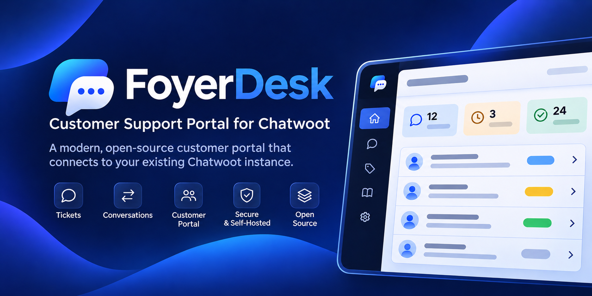
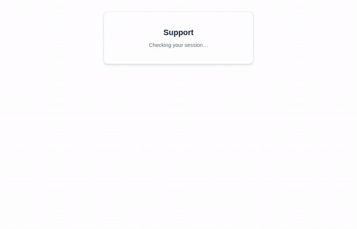
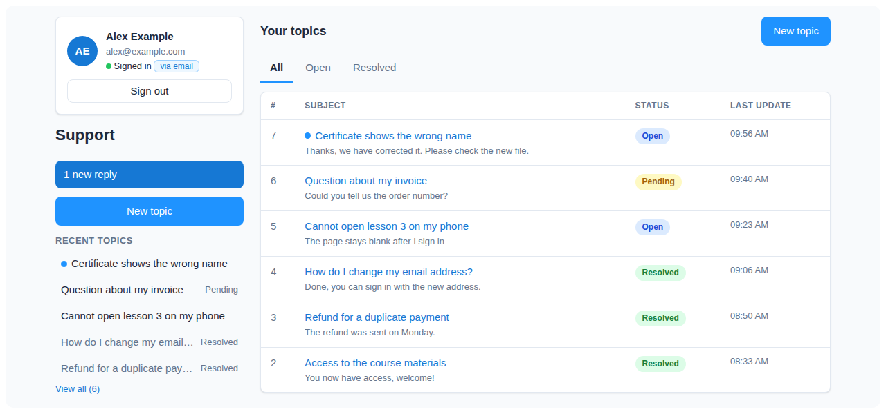
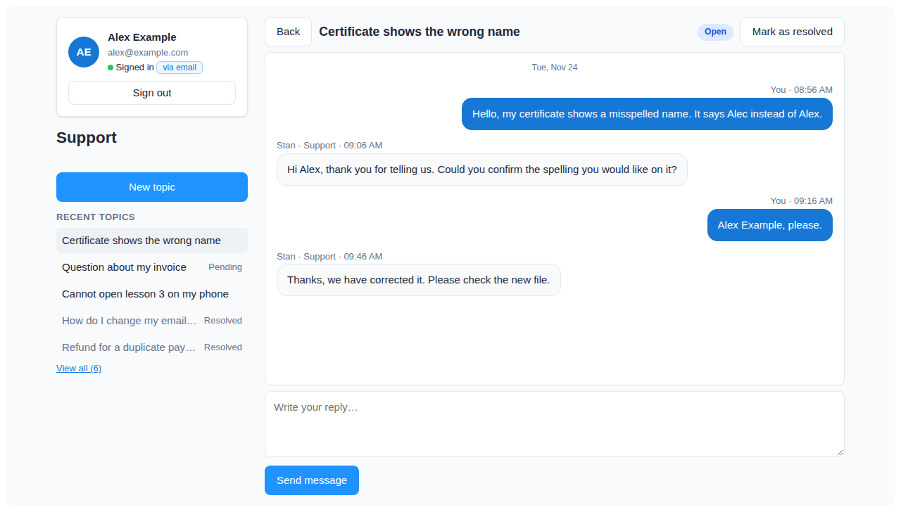
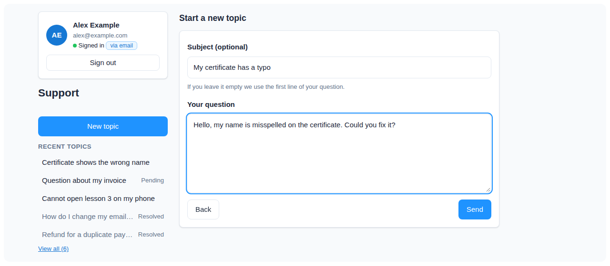
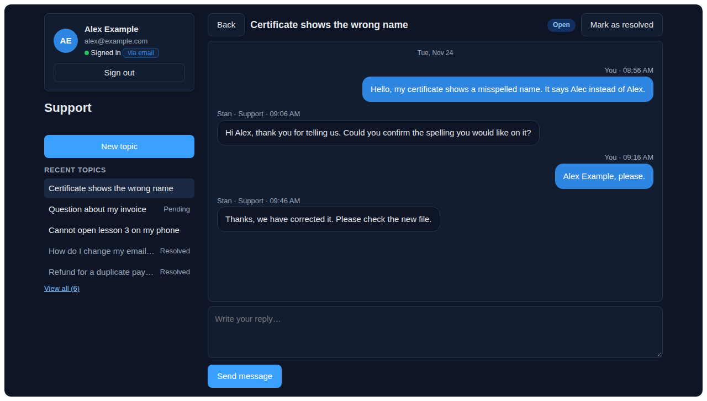
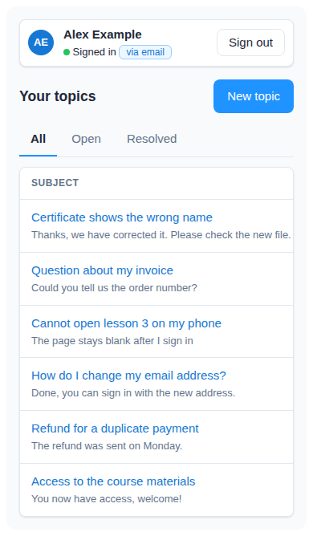
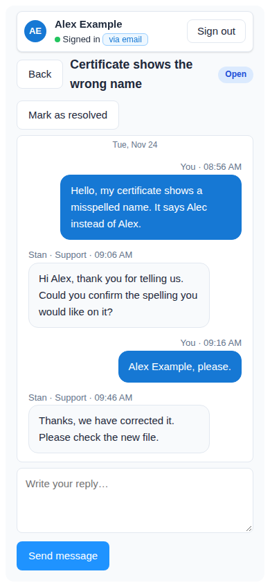
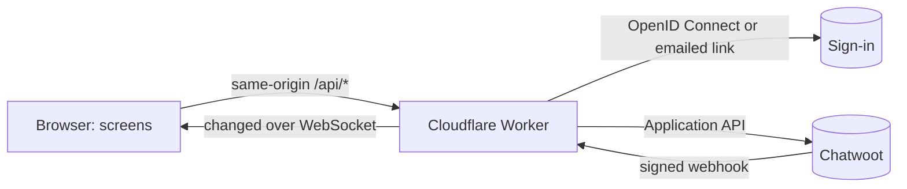

<p align="center">
  
</p>

<p align="center"><b>Customer support portal for Chatwoot.</b><br>
Customers sign in once, keep every topic, and see the team's reply live. Chatwoot stays the place where your team works.</p>

<p align="center">
  <a href="LICENSE"></a>
  
  
</p>

## What it is
Chatwoot's chat widget answers a visitor in the moment. FoyerDesk adds the part that comes after: a page on **your** site where a signed-in customer sees all their conversations, opens a new one, returns to an old one weeks later, closes a solved one, and gets the team's answer without reloading. Each topic is one Chatwoot conversation, so your team keeps working in Chatwoot as before. FoyerDesk keeps no database of its own.

**Status: 0.1.0, pre-release.** It runs in production on one site. Read [what is not verified yet](docs/architecture.md#not-verified-yet) before you rely on it.



## Screenshots
Real screens, demo data (see [docs/screenshots](docs/screenshots/README.md)). The interface still changes while this is a pre-release; the pictures are generated by `npm run media -w packages/ui` and can lag a few commits behind.

| | |
|---|---|
| <br>**Topics:** whole history, status badges, unread marker, tabs All, Open, Resolved. | <br>**Conversation:** its own scroll, reply box, mark as resolved or reopen. |
| <br>**New topic:** subject is optional; the first line is used. | <br>**Dark theme** follows the host page. |
| <br>**Phone:** list. | <br>**Phone:** conversation, account and Sign out stay in view. |

## Features (each one is in the code and covered by tests)
- Several topics per customer; one topic is one Chatwoot conversation in your inbox. Statuses shown: Open, Pending, Resolved.
- Full history with paging (25 a page), newest activity first; older messages load on demand; unread markers.
- Create a topic (subject optional), reply, mark as solved, reopen. Writing into a solved topic reopens it.
- Live replies: Chatwoot's signed webhook, then a WebSocket tells the open page to refresh. A slow check is only the safety net.
- Sign-in with any OpenID Connect provider, or an emailed one-time link. Sign-out and session-end pages.
- Safe retries: a lost answer never creates a duplicate topic or message.
- Responsive, dark theme, account card with Sign out that stays on screen. English text in one dictionary file per language.

Not included: attachments (off until server-side checks exist), an administrator screen (your team uses Chatwoot), languages other than English, Docker images.

## How it works

One site is one Chatwoot account and one Worker. The customer never chooses a department. Details: [docs/architecture.md](docs/architecture.md).

**Stack:** Cloudflare Workers and Durable Objects (JavaScript), [`jose`](https://github.com/panva/jose) for tokens, plain browser modules for the screens (no framework), Playwright and Miniflare for tests.

## Requirements
Node.js 22+, a Cloudflare account with your site's zone, Chatwoot 4.x (4.20.1 is the tested version), a way to sign customers in (an OpenID Connect provider, or a Resend account for the emailed link).

## Quick start
```
npm install
npm run demo -w packages/ui     # the real screens with demo data on http://127.0.0.1:4180/
npm run setup:browser
npm test                        # Worker unit and acceptance tests, then screen tests
```
To put it on your own site follow [docs/installation.md](docs/installation.md). There is **no Docker image or Compose file**: the server side is a Worker and the screens are static files.

## Documentation
[Installation](docs/installation.md) · [Configuration](docs/configuration.md) · [Chatwoot integration](docs/chatwoot-integration.md) · [Authentication](docs/authentication.md) · [Security](docs/security.md) · [Architecture](docs/architecture.md) · [Brand](docs/brand.md) · [Roadmap](docs/ROADMAP.md) · [Changelog](CHANGELOG.md)

## Security
The Chatwoot token stays on the server, every topic call checks ownership, writes need the site's own `Origin`, the webhook is signed, messages render as text. What is and is not covered: [docs/security.md](docs/security.md). Report vulnerabilities privately: [SECURITY.md](SECURITY.md).

## Roadmap
What is planned, what is known to be missing and what is not yet verified: [docs/ROADMAP.md](docs/ROADMAP.md).

## Contributing
See [CONTRIBUTING.md](CONTRIBUTING.md). Bug reports and pull requests are welcome; a failing test is the best bug report.

## License
Apache-2.0, see [LICENSE](LICENSE) and [NOTICE](NOTICE). Logo and name: see [docs/brand.md](docs/brand.md).
