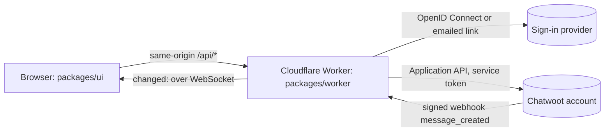

# Architecture

FoyerDesk is a thin layer between a customer's browser and a Chatwoot account. It has no database of its own: topics, messages, contacts and statuses live in Chatwoot. The Worker keeps only short-lived state in Cloudflare Durable Objects (sessions, one-time email links, rate counters, live-update sockets).

## One site, one account
One site is one Chatwoot account and one Worker deployment. The customer never chooses a department. Settings are Worker variables (see `SETUP_NEW_SITE.md`); nothing is shared between sites except the code.

## Sign-in
- **OpenID Connect**: authorization code with PKCE, the ID token is checked against the provider's JWKS (issuer, audience, nonce, signing algorithm from an allow-list), endpoints come from the discovery document. A verified email is required.
- **Emailed link** (optional, no provider needed): a random token, stored hashed for 15 minutes, usable once; the link opens a page with a button so mail scanners cannot use it up; three links per address and ten per IP in ten minutes; the answer is the same for every address.
- Either way the result is a *contact identifier* (a hash of issuer and subject, with a configurable prefix). The Worker finds or creates the Chatwoot contact for it and links it to the site's inbox. An email that already belongs to a different identifier is never merged silently.
- The browser only holds an opaque session cookie (`__Host-`, `HttpOnly`, `Secure`, `SameSite=Lax`). The session lives in a Durable Object: 30 minutes without use, 8 hours at most and is revoked on sign-out.

## Topics
One topic is one Chatwoot conversation. The Worker lists them with Chatwoot's paged filter endpoint (the per-contact list endpoint stops at 25 conversations). Statuses shown to the customer: Open, Pending, Resolved. Writing into a Resolved topic reopens it; the customer can mark a topic solved. At most ten topics may be open at once.

## Security rules
1. The Chatwoot token never reaches the browser.
2. Every call checks that the conversation belongs to the signed-in contact **and** to the site's inbox. A wrong or foreign id answers the same as a missing one.
3. State-changing requests must carry the site's own `Origin`.
4. Creating a topic or a reply is idempotent: the browser sends a request id, the Worker stores it on the message and recognises a retry even if the first answer was lost.
5. The webhook is accepted only with a valid Chatwoot signature; it tells the page "this topic changed" and carries no message text.
6. Messages are rendered as text, never as HTML. Attachments are off until server-side type and size checks exist.

## Live replies and the Cloudflare Free budget
Replies arrive by push: Chatwoot webhook, then a hibernating WebSocket to the page, plus a slow safety check. `docs/budget-model.mjs` estimates the daily request use. With 100 visits an hour for 24 hours it gives about 34% of the Free Worker quota (100,000 requests a day) and 58% of the Durable Object quota (100,000 requests a day); 1,000 visits spread over a day is about 14% and 24%. Past a daily limit the Free plan refuses further operations until 00:00 UTC, so sign-in and support stop; the Workers Paid plan removes the cliff. The visit shape (one send at 40 s, one at 130 s, one team reply) is an **assumption, not a measurement**.

What protects the quota from abuse: the session cookie is signed, so a random cookie is refused in the Worker before any Durable Object is asked; one customer is limited to 30 writes a minute (kept in memory, no storage write); the e-mail-link routes are off without a mail service. Not yet protected: the Worker request count itself (add one Cloudflare rate-limiting rule on `/api/*`; the Free plan allows one) and the idempotency ledger, which has no expiry.

## Not verified yet
- Providers other than Logto against a real login.
- The emailed link with a real mail service (tested with a fake one).
- Attachments (off).
- More than one site in production.
